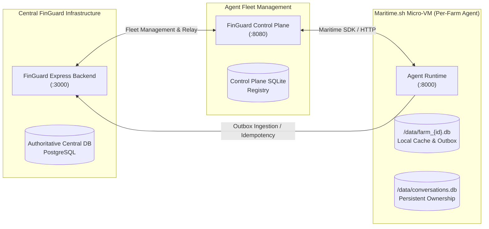
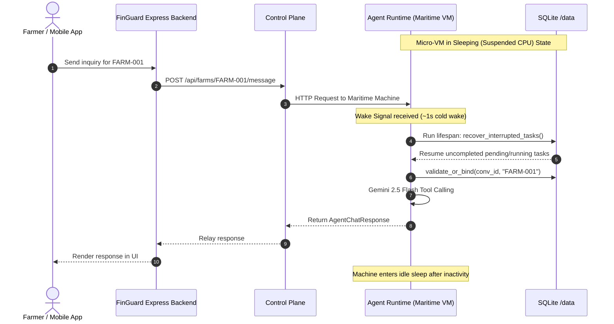

# FinGuard Express Backend Integration Contract

## 1. System Architecture & Component Roles



### Authoritative Central Storage (FinGuard Express / PostgreSQL)
FinGuard Express owns and serves as the single source of truth for:
1. **Farm Profiles & Tenant Entities**: `farm_id`, farm name, geographic coordinates, pond dimensions, assigned species.
2. **Official Diagnostic Records**: Pathogen candidates, lab confirmation status, veterinary sign-offs, severity ratings.
3. **Sensor Measurements**: IoT water-quality time-series (temperature, dissolved oxygen, pH, TAN, alkalinity).
4. **Permanent Observation Log**: Farmer-submitted logs, audit trails, and global notifications.

### Persistent Edge Storage (Maritime Micro-VM / SQLite `/data`)
Each Maritime agent maintains persistent local SQLite databases on `/data`:
1. **Episodic Conversation & Memory**: Short-term and long-term farmer memory items (`memory_items`), farm-bound conversation registry (`conversations.db`).
2. **Scientific Research Artifacts**: Asynchronous research inquiries, literature summaries, citations, execution locks, and retry state (`research_tasks`).
3. **Local Observation Outbox**: Pending farmer observations recorded via chat awaiting central synchronization (`observations`).
4. **Local Diagnostic Cache**: Read-only mirror for rapid offline tool access during reasoning (`diagnostics`).

---

## 2. API Contract Specification

### 2.1 Observation Ingestion Endpoint (Agent -> Express)
Pushes farmer observations from the agent's local outbox to the central backend.

- **Method / Path**: `POST /api/v1/farms/:farmId/observations`
- **Direction**: Agent Runtime / Outbox Manager -> FinGuard Express
- **Headers**:
  ```http
  Content-Type: application/json
  Idempotency-Key: <UUID-v4>
  X-FinGuard-Service-Key: <SHARED_SERVICE_KEY>
  ```
- **Request Body**:
  ```json
  {
    "observation_id": "OBS-B4A19F",
    "farm_id": "FARM-001",
    "pond_id": "Pond-02",
    "observation_type": "behavioral",
    "description": "Tilapia schooling at surface near aerator; reduced feeding activity.",
    "reported_by": "Ramesh Patel (Farm Manager)",
    "timestamp": "2026-11-15T05:30:00Z",
    "source": "farmer_chat",
    "related_diagnosis_id": "DX-90214A"
  }
  ```
- **Success Response (`201 Created` or `200 OK`)**:
  ```json
  {
    "success": true,
    "central_id": "CENTRAL-OBS-99410",
    "committed_at": "2026-11-15T05:30:02.145Z"
  }
  ```
- **Idempotent Duplicate Response (`409 Conflict`)**:
  Returned when the central backend has already committed an observation with the provided `Idempotency-Key`.
  ```json
  {
    "success": true,
    "central_id": "CENTRAL-OBS-99410",
    "committed_at": "2026-11-15T05:30:02.145Z",
    "duplicate": true
  }
  ```
- **Error Responses**:
  - `400 Bad Request`: Payload validation error.
  - `401 / 403 Forbidden`: Invalid or missing `X-FinGuard-Service-Key`.
  - `503 Service Unavailable`: Express database under maintenance. Local agent retains record in `pending` state and retries with bounded exponential backoff (`min(30s, 0.5 * 2^attempts)`).

---

### 2.2 Agent Chat Relay Endpoint (Express -> Control Plane -> Agent)
Relays end-user chat interactions from the FinGuard mobile app or web frontend through Express to the farm's dedicated agent.

- **Method / Path**: `POST /api/farms/:farmId/message`
- **Direction**: FinGuard Express -> Control Plane (`:8080`) -> Agent Runtime (`:8000`)
- **Headers**:
  ```http
  Content-Type: application/json
  Authorization: Bearer <JWT_USER_TOKEN>
  X-FinGuard-Service-Key: <SHARED_SERVICE_KEY>
  ```
- **Request Body**:
  ```json
  {
    "farm_id": "FARM-001",
    "message": "Did pond 2 show any signs of motile aeromonad septicemia last month?",
    "conversation_id": "conv-user-12345"
  }
  ```
- **Success Response (`200 OK`)**:
  ```json
  {
    "farm_id": "FARM-001",
    "response": "Based on diagnostic records for Pond-02, Motile Aeromonad Septicemia was suspected on October 14, 2026...",
    "tools_used": ["list_diagnostic_history", "compare_diagnostics"],
    "conversation_id": "conv-user-12345",
    "metadata": {
      "tool_executions": [
        {
          "tool": "list_diagnostic_history",
          "args": {"farm_id": "FARM-001"},
          "summary": "1 diagnostic record(s) found"
        }
      ]
    }
  }
  ```
- **Tenant Isolation Violation Response (`403 Forbidden`)**:
  Triggered if `conversation_id` is bound to another farm or if `farm_id` in URL / payload does not match the agent's provisioned tenant identity.
  ```json
  {
    "detail": "Conversation Isolation Violation: Conversation 'conv-user-12345' belongs to farm 'FARM-002', not 'FARM-001'."
  }
  ```

---

### 2.3 Deep Research Task Dispatch & Polling
Asynchronous literature and scientific evidence synthesis across FAO, WOAH, ICAR-CIFA, and NACA publications.

#### Create Research Task
- **Method / Path**: `POST /api/farms/:farmId/research`
- **Headers**: `X-FinGuard-Service-Key: <KEY>`, `Content-Type: application/json`
- **Request Body**:
  ```json
  {
    "question": "Efficacy of oxytetracycline immersion versus florfenicol oral feed for Edwardsiella ictaluri in Pangasius hypophthalmus",
    "related_diagnosis_id": "DX-77124B"
  }
  ```
- **Response (`202 Accepted` or `200 OK`)**:
  ```json
  {
    "research_task_id": "RES-8A3F10",
    "status": "pending",
    "question": "Efficacy of oxytetracycline immersion versus florfenicol oral feed...",
    "message": "Research task initiated asynchronously. Use task ID to retrieve results."
  }
  ```

#### Poll Research Task Status
- **Method / Path**: `GET /api/farms/:farmId/research/:taskId`
- **Response (`200 OK`)**:
  ```json
  {
    "research_task_id": "RES-8A3F10",
    "farm_id": "FARM-001",
    "research_question": "Efficacy of oxytetracycline immersion versus florfenicol oral feed...",
    "status": "completed",
    "findings": "Scientific Literature Review for '...':\n\nSource: Edwardsiellosis in Pangasius (ICAR-CIFA, 2023)...",
    "sources": [
      {
        "title": "Clinical management of Edwardsiellosis in freshwater catfish",
        "authors": "ICAR-CIFA Pathology Division",
        "year": 2023,
        "key_findings": "Florfenicol administered via medicated feed at 10 mg/kg biomass for 10 days..."
      }
    ],
    "created_at": "2026-11-15T05:40:00Z",
    "started_at": "2026-11-15T05:40:01Z",
    "completed_at": "2026-11-15T05:40:04Z",
    "failed_at": null,
    "retry_count": 0,
    "error_message": null
  }
  ```

---

## 3. Maritime Firecracker VM Hibernation Mechanics



### Technical Limitations & Recovery Rules
1. **CPU Suspension**: Maritime machines sleep when no incoming HTTP traffic arrives. Background in-memory asyncio loops or timer threads freeze while the VM is asleep.
2. **Durable Storage Guarantee**: Data written to `/data` persists across sleep/wake cycles, soft reboots, and container restarts.
3. **Automatic Startup Recovery**: Upon waking or restarting, `ResearchManager.recover_interrupted_tasks()` is automatically invoked during FastAPI `lifespan`. Any task left in `running` or `pending` state is evaluated:
   - If `retry_count < max_retries`: Execution lock is acquired, `started_at` is updated, and the task resumes execution.
   - If `retry_count >= max_retries`: Status transitions to `requires_review` with diagnostic error logging to prevent runaway retry loops.
4. **Execution Locks**: `execution_lock` prevents duplicate task processing if multiple workers or duplicate requests wake the machine concurrently.

---

## 4. Implementation Status Matrix

| Component / Contract | Agent Runtime Status | Control Plane Status | Central Express Status |
| :--- | :--- | :--- | :--- |
| **Observation Ingestion** | Implemented (`ObservationOutboxManager`) | N/A | Documented specification |
| **Idempotency Guarantee** | Implemented (`Idempotency-Key` tracking) | N/A | Documented specification |
| **Chat Message Relay** | Implemented (`/chat`) | Implemented (`/api/farms/:id/message`) | Documented specification |
| **Tenant Isolation (Farm)** | Implemented (`HTTP 403` on mismatch) | Implemented (Target routing) | Documented specification |
| **Conversation Ownership** | Implemented (`conversations.db` SQLite) | N/A | Documented specification |
| **Async Research Dispatch** | Implemented (`ResearchManager`) | Implemented (`/api/farms/:id/research`) | Documented specification |
| **Restart Recovery Worker** | Implemented (`lifespan` + `/research/recover`)| N/A | Documented specification |
| **Service Key Auth (`X-FinGuard-Service-Key`)** | Implemented | Implemented | Documented specification |

