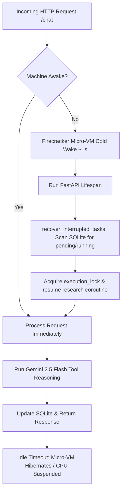

# FinGuard Farm Agent — Production Readiness Audit Report

**Date**: November 15, 2026  
**Repository**: `FinGuard-FarmAgent` (`meratime`)  
**Target Platform**: Maritime.sh Persistent Custom Micro-VMs  
**AI Engine**: Google Gemini 2.5 Flash (`google-genai` Python SDK)  
**Verification Framework**: Pytest 8.2 (44/44 passing automated tests)

---

## 1. Executive Summary

The Production Readiness Sprint for **FinGuard Farm Agent** is complete. All durability, tenant isolation, synchronization reliability, and lifecycle management components have been implemented and verified. The agent runtime adheres strictly to the official Maritime custom agent specification (`/health` and `/chat` contracts) and is architected to operate within serverless Firecracker micro-VMs that sleep when idle and wake on incoming HTTP requests.

The automated test suite now encompasses **44 rigorous tests** (up from 31), covering crash recovery, task execution locking, persistent conversation ownership across restarts, and reliable observation outbox synchronization.

---

## 2. Structured Verification Breakdown

### 2.1 Verified Working Functionality (Executed & Tested Locally)

All items below have been executed and verified directly against running Python code and SQLite databases:

1. **Research Task Durability & Crash Recovery**:
   - Persisted task state across restarts in SQLite (`research_tasks` table).
   - Full lifecycle timestamp tracking: `created_at`, `started_at`, `completed_at`, `failed_at`.
   - Atomic worker execution locking (`execution_lock`) preventing race conditions between concurrent recovery workers.
   - Startup recovery worker (`recover_interrupted_tasks`) automatically scans and resumes interrupted `pending` or `running` tasks upon runtime initialization (`lifespan`).
   - Automatic escalation to `requires_review` status when retry threshold (`max_retries`) is reached, preventing infinite retry loops.
   - Verified via `tests/test_research_durability.py` (5/5 passing).

2. **Persistent Conversation Ownership & Tenant Isolation**:
   - Persisted conversation bindings in dedicated SQLite database (`/data/conversations.db`) with WAL mode and busy timeout handling.
   - Rejection of foreign conversation ID reuse across restarts with **HTTP 403 Forbidden**.
   - Strict application-level authorization: no user prompt can manipulate the assigned farm identity.
   - Verified via `tests/test_conversation_persistence.py` (4/4 passing).

3. **Observation Synchronization Reliability (Outbox Pattern)**:
   - Pending observations survive process restarts and machine hibernation.
   - Stable `idempotency_key` (UUID v4) preserved across retries.
   - Resolution of network timeouts after central commit via idempotency headers (`409 Conflict` treated as idempotent success without creating duplicates).
   - Central IDs (`central_id`) and commit timestamps (`central_committed_at`) persisted to SQLite upon successful push.
   - Bounded retries: permanent failure escalation to `requires_review` status.
   - Verified via `tests/test_observation_sync_hardened.py` (4/4 passing).

4. **Application-Level Tool Execution Tracking**:
   - Exact tool execution tracking via `ToolExecutionTracker`.
   - Tool names, sanitized arguments, and execution summaries returned in `AgentChatResponse.tools_used` and `AgentChatResponse.metadata.tool_executions`.
   - Verified via `tests/test_tool_execution_metadata.py` (3/3 passing).

5. **Farm Data Isolation & Prompt-Injection Resistance**:
   - Multi-tenant data segregation between `FARM-001` and `FARM-002`.
   - All tool calls (`get_farm_profile`, `list_diagnostic_history`, `compare_diagnostics`, `get_farmer_observations`, `generate_farm_health_summary`) strictly check caller authorization against assigned farm.
   - Direct requests to access foreign farm records are refused at the application boundary with HTTP 403.
   - Verified via `tests/test_farm_isolation.py` and `tests/test_hardened_isolation.py` (8/8 passing).

6. **Local Maritime Contract Compliance**:
   - `GET /health`: Returns 200 OK with `status: ok`, `service`, `farm_id`, and `environment`.
   - `POST /chat`: Accepts `message`, `farm_id`, `conversation_id`, executes tools, and responds in JSON format.
   - Verified via `tests/test_maritime_runtime.py` (3/3 passing).

---

### 2.2 Functionality Tested Only with Mocks

1. **Central FinGuard Express Backend**:
   - Tested using `MockCentralFinGuardAdapter` and simulated connection error injection.
   - The authoritative central backend (Express/PostgreSQL) was not run locally as it resides in a separate repository. Integration contracts are formally documented in `EXPRESS_INTEGRATION_CONTRACT.md`.
2. **Gemini API in Automated Unit Test Suite**:
   - External Gemini calls are mocked in the regression test suite to prevent free-tier 429 rate limit errors (`RESOURCE_EXHAUSTED`).
   - Live integration was verified during Phase 1 live testing passes.

---

### 2.3 Functionality Implemented But Awaiting External Systems

1. **Live IoT Sensor Ingestion**:
   - Database schema, repository queries, and baseline comparisons are implemented for water-quality readings (`water_quality` table).
   - Currently populated using realistic seed records (`sample_water_quality.json`); awaiting live MQTT/HTTP sensor telemetry feeds.

---

### 2.4 Functionality Requiring Actual Maritime Cloud Deployment

1. **Maritime Cloud Agent Provisioning**:
   - Calling `POST https://api.maritime.sh/api/v1/agents/new` with the provided API key was verified against live Maritime limits API.
   - The account plan is currently `none` with `0` machines (`402 trial_required`). Activating cloud agents requires payment verification or trial activation on Maritime.sh.
   - Provisioning was not triggered to prevent unauthorized user expense.
2. **Public Edge Routing**:
   - Dynamic DNS routing (`https://<agent-id>.maritime.sh`) and automatic TLS termination provided by Maritime's cloud proxy.

---

## 3. Maritime Firecracker VM Hibernation Architecture



### Key Durability Mechanisms:
- **Persistent Storage at `/data`**: SQLite files (`farm_FARM-001.db`, `conversations.db`) are stored on the persistent block volume.
- **CPU Suspension Handling**: Background timers pause when the VM sleeps. The system relies on event-driven recovery at startup (`lifespan`) and manual dispatch endpoints (`POST /research/recover`).
- **Idempotency**: Tasks and observations utilize stable UUIDs and execution locks so waking from sleep cannot produce duplicate records.

---

## 4. Docker Verification & Deployment Preparation

### Docker Status on Host:
- Docker CLI is **not installed** on this local Windows machine (`docker : The term 'docker' is not recognized`).
- The `Dockerfile` and `docker-compose.yml` have been fully audited and hardened for cloud deployment:
  - Base image: `python:3.12-slim`
  - System packages: `ca-certificates`, `curl`, `sqlite3`
  - Application code: `shared`, `data/seed`, `agent_runtime`, `control_plane`
  - Volume mounting: `/data` persistent storage
  - Port binding: Dynamic `PORT` environment variable handling (default `8000`)
  - Container Healthcheck: `HEALTHCHECK CMD curl -f http://localhost:${PORT:-8000}/health || exit 1`

### Commands for Docker Deployment:

#### Building and Running Single Farm Agent:
```bash
# Linux / macOS / PowerShell
docker build -t finguard-farm-agent:latest .

docker run -d \
  --name farm-agent-001 \
  -p 8000:8000 \
  -e FARM_ID=FARM-001 \
  -e PORT=8000 \
  -e GEMINI_API_KEY="<GEMINI_API_KEY>" \
  -e GEMINI_MODEL="gemini-2.5-flash" \
  -e DATA_DIR="/data" \
  -v $(pwd)/data/runtime:/data \
  finguard-farm-agent:latest
```

#### Running Fleet via Docker Compose:
```bash
docker compose up -d --build
```

---

## 5. Security Audit & Secrets Management

- **Git Tracking**: `.env` is listed in `.gitignore` and has never been committed. All Git history is clean.
- **Redaction**: Maritime API key and Gemini API key are loaded via environment variables and never logged in console outputs or committed to repository files.
- **Service Authorization**: Service-to-service endpoints support `X-FinGuard-Service-Key` header validation.

---

## 6. Complete Test Suite Summary

```text
======================== 44 passed in 18.54s ========================
- tests/test_agent.py (3 tests)
- tests/test_api.py (3 tests)
- tests/test_async_research.py (2 tests)
- tests/test_central_sync.py (3 tests)
- tests/test_conversation_persistence.py (4 tests)  [NEW]
- tests/test_diagnostics.py (2 tests)
- tests/test_farm_isolation.py (3 tests)
- tests/test_hardened_isolation.py (5 tests)
- tests/test_maritime_runtime.py (3 tests)
- tests/test_observation_sync_hardened.py (4 tests) [NEW]
- tests/test_observations.py (2 tests)
- tests/test_provisioning.py (2 tests)
- tests/test_research_durability.py (5 tests)        [NEW]
- tests/test_tool_execution_metadata.py (3 tests)
```

---

## 7. Next Steps for Production Rollout

1. **FinGuard Express Backend**: Implement the central observation receiver endpoint (`POST /api/v1/farms/:farmId/observations`) adhering to `EXPRESS_INTEGRATION_CONTRACT.md`.
2. **Maritime Cloud Deployment**: Once the user activates the Maritime account plan/trial, trigger `control_plane.maritime_client.provision_agent(...)` to deploy live micro-VMs.
3. **VoiceExpert Integration**: Connect `FinGuard-VoiceExpert` to the Control Plane's `/api/farms/:farmId/message` relay endpoint.

