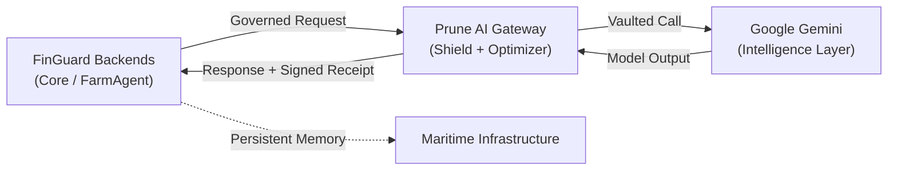

# FinGuard-PruneIntegration

> Production-minded, secure AI Gateway integration between **Prune AI Gateway** and the **FinGuard Aquaculture Intelligence Platform**.

---

## 1. Executive Summary & Purpose

FinGuard is an Aquaculture Intelligence Platform designed to monitor pond telemetry, screen fish diseases, provide persistent farm memory, and deliver diagnostic reasoning for aquaculture operations.

**Prune AI Gateway** is a managed AI traffic governance proxy (`https://api.withprune.com/v1`) that sits between FinGuard's backend services and upstream Large Language Model (LLM) providers (specifically Google Gemini).

### Why Prune is NOT an AI Agent
Prune is **not** an AI model, autonomous agent, or replacement for Gemini or Maritime:
- **Prune is an AI traffic governance layer**: It handles credential vaulting, Shield security policies, spend limits, rate limits, request optimization, exact caching, and cryptographic receipt issuance.
- **Gemini is the intelligence layer**: It performs biological reasoning, fish pathology screening, and report drafting.
- **Maritime is the agent infrastructure**: It manages persistent farm-specific memory, historical incident retrieval, and multi-step research workflows.



---

## 2. Capability & Compatibility Matrix

| Request Category | Target Route | Verification Status | Cache Policy | Details |
| :--- | :--- | :--- | :--- | :--- |
| **General Text & Explanations** | Prune Gateway | **VERIFIED** | `exact` (opt-in) | Non-sensitive static knowledge. |
| **Clinical Disease Diagnosis** | Prune Gateway | **VERIFIED (Text)** | `off` (Mandatory) | Telemetry & pathology reasoning; zero caching. |
| **Farm Operational Conversations** | Prune Gateway | **VERIFIED** | `off` (Mandatory) | Farmer observations & logs; zero caching. |
| **Agent Tool Execution (Maritime)**| Prune Gateway | **VERIFIED** | `off` (Mandatory) | Run tracking (`run_id`, `run_budget_usd`). |
| **Multimodal Images (Fish Photos)** | Direct Gemini | **UNVERIFIED on Gateway** | N/A (Direct) | Kept on direct Gemini provider path. |
| **Real-Time Voice (Gemini Live)** | Direct Gemini Live | **EXCLUDED from Gateway** | N/A (Direct) | WebSockets & live audio bypass HTTP proxy. |

---

## 3. Prune Setup & Credential Management

### Step 1: Create a Prune Account
Visit [https://app.withprune.com](https://app.withprune.com) and create an account.

### Step 2: Vault Your Google Gemini Key
1. Go to **Connect** → **Providers** in the Prune Dashboard.
2. Select **Google Gemini**.
3. Input your Gemini API key (`AIza...`).
4. Prune stores this key encrypted at rest with **AES-256-GCM** using dedicated key separation. Application code never accesses raw Gemini credentials.

### Step 3: Create a Prune Gateway Key
1. Go to **Connect** → **API Keys**.
2. Click **Create Key** (starts with `prune_`).
3. Store this in your environment as `PRUNE_API_KEY`.

---

## 4. Local Environment Configuration

Copy `.env.example` to `.env`:
```bash
cp .env.example .env
```

Key environment settings:
```env
# Prune Gateway credentials
PRUNE_API_KEY=prune_live_your_key_here
PRUNE_BASE_URL=https://api.withprune.com/v1

# Master kill-switch (defaults to false for safety)
PRUNE_ENABLED=false

# Operating mode: shadow | active
PRUNE_MODE=shadow

# Attribution tags
PRUNE_DEFAULT_FEATURE_ID=general_chat
PRUNE_DEFAULT_WORKLOAD=finGuard_core

# Safety and retry controls
PRUNE_TIMEOUT_SECONDS=30
PRUNE_MAX_RETRIES=1
PRUNE_CACHE_POLICY=disabled
PRUNE_ALLOW_DIRECT_FALLBACK=false

# Model target
GEMINI_MODEL=gemini-1.5-flash
```

---

## 5. Running the Adapters

### 5.1 TypeScript Adapter (FinGuard Core / Express)
```bash
cd typescript
npm install
npm test
```

Using the client in Express code:
```typescript
import { FinGuardPruneClient, RequestCategory } from './src';

const client = new FinGuardPruneClient();

const response = await client.createChatCompletion({
  category: RequestCategory.GENERAL_TEXT,
  featureId: 'general_chat',
  workload: 'finGuard_core',
  farmId: 'FARM-001',
  messages: [{ role: 'user', content: 'What is the optimal pH range for freshwater prawns?' }],
});

console.log('Model Response:', response.content);
console.log('Receipt:', response.receipt);
```

### 5.2 Python Adapter (FinGuard-FarmAgent / FastAPI)
```bash
cd python
pip install -r requirements.txt
python -m pytest tests -v
```

Using the client in FastAPI / FarmAgent:
```python
from src.client import FinGuardPruneClient
from src.router import RequestCategory

client = FinGuardPruneClient()

response = client.create_chat_completion(
    messages=[{"role": "user", "content": "Analyze aeration logs for Pond 3."}],
    category=RequestCategory.FARM_CONVERSATION,
    farm_id="FARM-001",
    feature_id="farm_agent",
    workload="finGuard_farm_agent",
    run_id="run_agent_981",
    run_budget_usd=0.05,
)

print("Agent Response:", response.content)
print("Cost (USD):", response.receipt.cost_usd)
print("Receipt Signature:", response.receipt.receipt_signature)
```

---

## 6. Testing Strategy

### 6.1 Mock Unit Tests (Zero Billable Requests)
Both test suites run entirely offline with mock transports and synthetic cryptographic tests:
```bash
# TypeScript Unit Tests (15 tests)
cd typescript && npm test

# Python Unit Tests (16 tests)
cd python && python -m pytest tests -v
```

### 6.2 Optional Live Verification Test
To make a real, minimal 1-token test call to Prune Gateway using live credentials:
```bash
cd python
$env:ENABLE_LIVE_PRUNE_TESTS="true"
$env:PRUNE_API_KEY="prune_live_..."
python -m pytest tests/test_live.py -v
```

---

## 7. Inspecting Prune Receipts

Every proxied request attaches a `prune_metadata` object, normalized into `FinGuardReceipt`:

```json
{
  "request_id": "chatcmpl_89fd72ba",
  "farm_id": "FARM-001",
  "feature_id": "disease_screening",
  "workload": "finGuard_core",
  "requested_model": "gemini-1.5-flash",
  "actual_model": "gemini-1.5-flash",
  "cache_hit": false,
  "cache_type": null,
  "input_tokens": 42,
  "output_tokens": 120,
  "cost_usd": 0.000045,
  "cost_saved_usd": 0.000015,
  "tokens_saved": 0,
  "optimizations_applied": ["cheaper_model_routing"],
  "receipt_signature": "MEQCIBase64Ed25519Signature...",
  "receipt_key_id": "prune_pubkey_2026_v1",
  "created_at": "2026-11-15T03:30:00Z"
}
```

Offline verification of the cryptographic signature is available in `src/receipt.py` using `verify_receipt_offline()`.

---

## 8. Safe Caching Policies

- **Strict NO CACHE (`X-Prune-Cache: off`)**:
  - Disease diagnosis and clinical reasoning.
  - Current water-quality readings (pH, DO, ammonia).
  - Farm-specific observations and historical logs.
  - Tool-calling agent executions.
- **Exact Match Caching (`X-Prune-Cache: exact`)**:
  - Allowed **only** for `RequestCategory.STATIC_EDUCATIONAL` queries (species biology, static reference facts).
- **Semantic Caching**: Strictly prohibited across all FinGuard workflows to prevent cross-tenant leakage or false clinical equivalences.

---

## 9. Spending & Rate Limits

Prune Shield provides two levels of financial protection:
1. **Account-Level Hard Ceiling**: Configured in the Prune Dashboard (daily / monthly dollar limits). Rejections return HTTP 429 with `X-Prune-Shield-Code: spend_cap`.
2. **Per-Agent Run Budgets**: Attached via `X-Prune-Run-Budget-Usd` and `X-Prune-Max-Steps`. When an agent loop exceeds the budget, Shield terminates further calls.

---

## 10. Disabling Prune & Fallback Behavior

- Set `PRUNE_ENABLED=false` to disable gateway integration.
- Direct provider fallback is governed by `PRUNE_ALLOW_DIRECT_FALLBACK=false` by default. When false, failures fail closed to prevent accidental spend or unshielded provider leaks.

---

## 11. Troubleshooting Common Errors

| Error | Root Cause | Resolution |
| :--- | :--- | :--- |
| `PruneSpendCapError` (`spend_cap`) | Daily or run spending ceiling reached. | Do not retry. Contact FinOps to adjust limits. |
| `PruneRateLimitError` (`rate_limit`)| Gateway RPM/TPM limit exceeded. | Adapter automatically applies exponential backoff. |
| `PruneShieldUnavailableError` | Gateway database timeout during Shield check. | Transient 503 error; retryable. |
| `PruneAuthenticationError` (401) | Invalid or expired `PRUNE_API_KEY`. | Verify key in `.env`. |
| `PruneDirectFallbackProhibitedError`| Bypassed route (voice/image) blocked. | Explicitly configure direct provider route or fallback toggle. |

---

## 12. Future Integration Roadmap

- **FinGuard Core**: Replace raw fetch/axios LLM invocations in `services/aiService.ts` with `FinGuardPruneClient.createChatCompletion()`.
- **FinGuard-FarmAgent**: Point FastAPI agent workflows to Python adapter with Maritime session IDs mapped to `run_id`.
- **FinGuard-VoiceExpert**: Retain on direct Gemini Live API (WebSockets) until Prune releases official audio streaming support.

