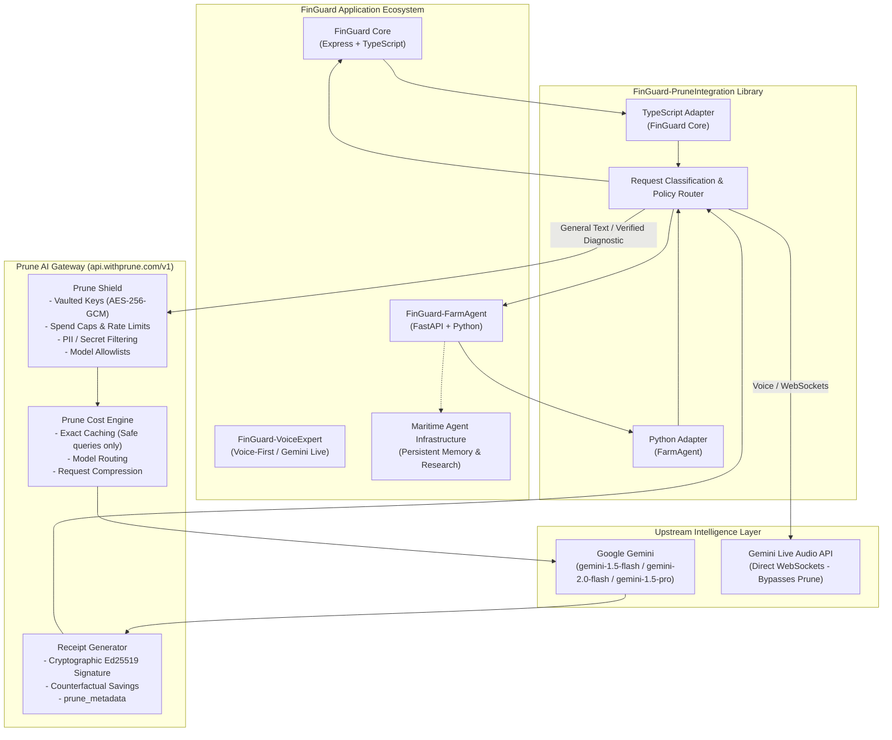

# FinGuard AI Gateway Architecture: Prune Integration

## 1. Executive Overview

**FinGuard** is an Aquaculture Intelligence Platform designed to monitor pond telemetry, screen fish diseases, provide persistent farm memory, and deliver diagnostic reasoning for aquaculture farmers.

**Prune AI Gateway** is an external, managed AI gateway and traffic governance layer that sits between FinGuard's backend services and upstream Large Language Model (LLM) providers (specifically Google Gemini).

---

## 2. Fundamental Architectural Boundaries

### What Prune IS
- **A Managed AI Traffic Governance Layer**: Sits between FinGuard backends and LLM providers.
- **A Credential Vault**: Stores Google Gemini API keys securely encrypted with AES-256-GCM at rest, preventing keys from existing in local environments or frontend code.
- **A Security & Spend Gatekeeper**: Evaluates Shield policies (spending limits, rate limits, allowlists) *before* requests hit Google Gemini.
- **An Observability & Proof Provider**: Emits signed cryptographic receipts (`prune_metadata`) tracking token usage, actual vs. requested models, and counterfactual cost savings.
- **A Safe Caching Layer**: Provides exact-match caching for approved, non-sensitive, deterministic queries.

### What Prune IS NOT
- **NOT an AI Model**: Prune performs no biological reasoning, medical diagnostics, or aquaculture analysis.
- **NOT an Autonomous Agent**: Prune has no goal-directed loop, planning capacity, or tool-calling orchestration.
- **NOT a Replacement for Gemini**: Google Gemini remains the core intelligence engine for reasoning, fish pathology screening, and report generation.
- **NOT a Replacement for Maritime**: Maritime remains the stateful agent platform powering farm-specific memory, diagnostic incident comparison, and research workflows.
- **NOT a Self-Hosted Microservice**: This repository provides lightweight, embeddable SDK adapters for TypeScript and Python, not an extra proxy daemon to operate.

---

## 3. Component Interaction & Request Lifecycle

1. **FinGuard Backend Invocation**:
   - FinGuard Core (Node.js) or FarmAgent (Python) initiates an LLM request for a specific user action (e.g., pond health question, general aquaculture advice).
2. **Context & Policy Classification**:
   - The Request Classifier (`router.ts` / `router.py`) inspects the request category, farm context, and payload characteristics.
   - Farm-specific sensitive data is flagged: semantic caching is strictly prohibited.
   - Live audio/WebSocket requests are routed directly to Gemini Live, bypassing Prune.
3. **Gateway Dispatch via Adapter**:
   - The adapter attaches trusted metadata headers:
     - `X-Prune-Customer-Id`: Secure backend customer identifier (e.g., `cust_farm_102`).
     - `X-Prune-Feature-Id`: FinGuard feature name (e.g., `general_chat`, `disease_screening`).
     - `X-Prune-Workload`: Originating service (`finGuard_core`, `finGuard_farm_agent`).
     - `X-Prune-Cache`: Conservative cache policy (`off` or `exact`).
     - Agent tracking headers (`X-Prune-Run-Id`, `X-Prune-Run-Budget-Usd`, `X-Prune-Max-Steps`) where applicable.
4. **Prune Shield Evaluation (Fail-Closed)**:
   - Evaluates API key validity (HMAC-SHA256).
   - Validates spending caps, rate limits, and model allowlists.
   - If limits are exceeded or Shield is unavailable, Prune terminates the call upstream with HTTP 429/503 and returns `X-Prune-Shield-Code`.
5. **Upstream Model Execution**:
   - Prune unvaults the stored Google Gemini provider key and dispatches the completion request to Gemini.
6. **Receipt Generation & Response Normalization**:
   - Prune returns the provider completion along with the `prune_metadata` object and response headers (`X-Prune-Provider`, `X-Prune-Cache-Hit`, `X-Prune-Shield-Code`).
   - The adapter parses the response into FinGuard's normalized internal receipt model (`FinGuardReceipt`), providing clean observability metrics to the host application without logging raw prompts or secrets.

