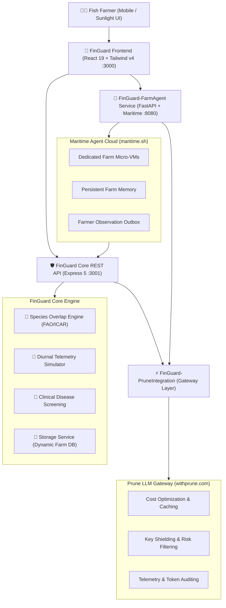

<div align="center">

# 🐟🛡️ FinGuard.io (AquaSentinel)
### Enterprise Species-Aware Aquaculture Intelligence & Telemetry Platform
**Powered by Maritime Autonomous Agents & Prune LLM Gateway**

[](https://www.typescriptlang.org/)
[](https://react.dev/)
[](https://expressjs.com/)
[](https://fastapi.tiangolo.com/)
[](https://www.python.org/)
[](https://maritime.sh)
[](https://withprune.com)
[](https://vitejs.dev/)
[](https://tailwindcss.com/)
[](https://github.com/harshitag20/FinGuard)

[System Architecture](#-system-architecture) • [Maritime Integration](#-special-challenge-best-use-of-maritime) • [Prune Integration](#-special-challenge-best-use-of-prune) • [Farmer UI Redesign](#-mobile-first-farmer-ui-redesign) • [API Contracts](#-api-endpoints) • [Quickstart](#-quickstart-guide)

</div>

---

## 📌 Executive Overview

**FinGuard.io** is an enterprise aquaculture intelligence platform engineered for commercial fish farms, polyculture operations, and marginal rural culturists. Unlike generic farm management dashboards, FinGuard grounds every biological threshold, water parameter, and disease diagnostic in peer-reviewed reference literature from the **Food and Agriculture Organization (FAO)** and the **Indian Council of Agricultural Research (ICAR-CIFA)**.

FinGuard integrates three purpose-built microservices into a cohesive production ecosystem:
1. **FinGuard Core**: Central Express 5 + React 19 web platform for farm registry, water quality telemetry, species physiological corridors, and clinical laboratory screening.
2. **FinGuard-FarmAgent**: Independent Python/FastAPI service deploying **one dedicated, persistent autonomous AI agent per farm**, hosted on **Maritime's agent cloud infrastructure**.
3. **FinGuard-PruneIntegration**: High-throughput gateway routing LLM requests through **Prune**, securing API credentials, minimizing inference expenditure, and recording verifiable telemetry receipts.

---

## 🏆 Hackathon Track Highlights

FinGuard actively tackles and implements two major special challenge tracks from **VIHAAN-X** (IEEE DTU):

### 🚢 Special Challenge: Best Use of Maritime

> **"Maritime is the fully managed cloud for running AI agents at scale, built for billions of agents."** — *maritime.sh*

FinGuard leverages **Maritime** to power **FinGuard-FarmAgent**, giving every fish farm an autonomous, stateful digital farm manager running in an isolated micro-VM:

```
┌─────────────────────────────────────────────────────────────────────────────┐
│                       MARITIME AGENT INFRASTRUCTURE                         │
│                                                                             │
│  ┌───────────────────────┐   ┌───────────────────────┐   ┌───────────────┐  │
│  │ FarmAgent: FARM-001   │   │ FarmAgent: FARM-002   │   │ FarmAgent: N  │  │
│  │ • Persistent Memory   │   │ • Persistent Memory   │   │ • Memory      │  │
│  │ • Observation Journal │   │ • Observation Journal │   │ • Journal     │  │
│  │ • Tool Execution      │   │ • Tool Execution      │   │ • Tools       │  │
│  └───────────┬───────────┘   └───────────┬───────────┘   └───────┬───────┘  │
└──────────────┼───────────────────────────┼───────────────────────┼──────────┘
               │ Tool Calls (REST / Outbox)│                       │
               ▼                           ▼                       ▼
    ┌──────────────────────────────────────────────────────────────────────┐
    │          FinGuard Core Backend Microservice (Authoritative DB)       │
    │        Pond Telemetry • Disease Diagnostics • Farmer Identity        │
    └──────────────────────────────────────────────────────────────────────┘
```

#### Why Maritime is Essential to FinGuard:
- **One Persistent Agent per Farm**: Every registered farm (`FARM-001`, `FARM-002`, etc.) automatically provisions an isolated, long-lived agent instance that preserves context, seasonal weather records, and farmer observations over months of growth cycles.
- **Autonomous Tool Execution**: Agents use sandboxed Maritime tools to securely query live water quality telemetry, fetch species profiles from ICAR-CIFA databases, and cross-reference diagnostic reports.
- **Farmer Observation Journal**: Farmers log informal field notes (*"Aerator belt slipped this morning"*, *"Water turned brownish-green"*), which Maritime agents ingest into persistent memory to correlate with future water quality shifts.
- **Outbox Synchronization**: When operating in remote pond sites with intermittent connectivity, Maritime agents queue state updates in a transactional outbox and synchronize seamlessly once back online.
- **Local & Cloud Resilience**: Runs against live Maritime Scale clusters (`maritime.sh`) via `MARITIME_API_KEY`, with zero-downtime mock boundary adapters for local testing.

---

### ⚡ Special Challenge: Best Use of Prune

> **"Prune helps you reduce LLM API costs, secure API keys, block risky requests, and monitor every AI call — all in one platform."** — *withprune.com*

FinGuard integrates **Prune** as its centralized **Model Routing & AI Gateway Layer** across both the Node.js backend and the Python FarmAgent service:

```
    User Inquiries / Screening / Agent Prompts
                      │
                      ▼
        ┌───────────────────────────┐
        │   FinGuard Prune Gateway  │
        │     Client & SDK Layer    │
        └─────────────┬─────────────┘
                      │
        ┌─────────────┴─────────────┐
        ▼                           ▼
┌────────────────────────┐  ┌──────────────────────────────────────────────┐
│   Security & Guardrail │  │         Cost-Optimized Model Routing         │
│ • Mask & Protect Keys  │  │ • High-Volume Queries ──► Prune Cached Tier  │
│ • Block Risky Prompts  │  │ • Multi-Agent Chats   ──► Cost-Managed Route │
│ • Cryptographic Audit  │  │ • Vision & Multimodal ──► Direct Gemini Tier │
└────────────────────────┘  └──────────────────────────────────────────────┘
                      │
                      ▼
         [ Prune Analytics & Latency Telemetry ]
         Cost per query • Token usage • Latency receipts
```

#### Why Prune is Essential to FinGuard:
- **Cost Reduction for High-Frequency Queries**: Aquaculture ponds sample telemetry every few seconds and farmers ask repetitive queries (*"Is my oxygen safe?"*). Prune drastically reduces API overhead through intelligent caching and cost-optimized model routing.
- **Credential Protection**: Client applications and rural field tablets never touch raw foundation model API keys; all traffic is routed through Prune's secure proxy.
- **Dual SDK Integration**: Provides native bi-directional client libraries in both:
  - **TypeScript**: `FinGuardPruneClient` (npm package in `FinGuard-PruneIntegration/typescript/`)
  - **Python**: `PruneClient` (package in `FinGuard-PruneIntegration/python/`)
- **Verifiable Audit Receipts**: Every AI response includes cryptographic metadata receipts logging provider name, model version, exact token consumption, and latency metrics displayed directly in the user UI.
- **Dynamic Fallback Policies**: If cloud endpoints encounter rate limits, Prune automatically and safely falls back through configured secondary tiers without disrupting farm operations.

---

## 🏛️ System Architecture



---

## 📱 Mobile-First Farmer UI Redesign

Engineered specifically for small and marginal fish farmers in India operating in direct sunlight on low-end Android devices:

| Screen | Key Features | Farmer Experience |
|---|---|---|
| **1. Daily Farm Report (Home)** | • 24h summary with traffic-light status (🟢 / 🟡 / 🔴)<br>• 4 expandable parameter rows (Oxygen, Ammonia, Temp, pH)<br>• Safe range indicators and 24h trend sparklines<br>• Single-action issue resolution buttons (*"Run aerator"*)<br>• 🔊 **Voice Audio Assistance** via Web Speech API (`hi-IN` & `en-IN`)<br>• Language switcher (**English / हिन्दी**) in header | Understands pond safety within **5 seconds** without knowing technical acronyms like DO, TAN, or hysteresis. |
| **2. Live Pond Status (Live Stream)** | • Real-time line charts powered by **Recharts**<br>• Shaded green **safe-zone bands** calculated from species limits<br>• Breach indicators turning amber/red with breach dots<br>• Simplified Demo Mode with Play/Pause, Reset & speed selector (Slow/Normal/Fast)<br>• Emergency practice scenarios: *Night Oxygen Drop* & *Ammonia Rise*<br>• Actionable alert cards (*"Switch on aerator"*) | Eliminates confusing static number walls; visually shows water trends entering and exiting safe zones. |
| **3. Government Help (Schemes)** | • **"Am I eligible?"** 3-question quick helper (Role, Category, Need)<br>• Matching schemes with **"Best match for you ⭐"** badge<br>• Plain benefit explanations (e.g., *40% to 60% PMMSY subsidy*)<br>• 1-tap **Application Checklist Bottom Sheet**<br>• Auto-fills farm details from profile and shares checklist to WhatsApp | Takes the farmer from discovery to official government application in **under 3 taps**. |
| **Smart Onboarding Flow** | • Cleaned **DEMO SIGN IN** button (no emoji clutter)<br>• Seamless sequential progression: **Step 1 (Sign In) $\rightarrow$ Step 2 (Location & Weather) $\rightarrow$ Step 3 (Species) $\rightarrow$ Step 4 (Pond Specifications)** | Smooth, reliable setup tailored for both field demos and live farming registration. |

---

## 📂 Repository Structure

```
FinGuard/
├── backend/                             # FinGuard Core Backend (Express 5 + TypeScript)
│   ├── src/
│   │   ├── config/                      # Environment settings (Gemini, FarmAgent, Prune)
│   │   ├── controllers/                 # Express route handlers
│   │   ├── middleware/                  # Dynamic farm authorization & access control
│   │   ├── routes/                      # API routing (Core /api and FarmAgent /api/v1)
│   │   ├── services/                    # Business logic (Simulation, Pathology, Storage, Prune)
│   │   └── data/                        # Persistent file-backed application store
│   └── tests/                           # Vitest E2E & unit test suites (47/47 passing)
│
├── frontend/                            # FinGuard Client (React 19 + Vite + Tailwind v4)
│   ├── src/
│   │   ├── components/common/           # Accessible mobile controls (StatusPill, MetricCard, LiveChartCard)
│   │   ├── screens/                     # Redesigned screens (Dashboard, PondMonitoring, Schemes, etc.)
│   │   ├── services/                    # Client API adapters, weather, location & disease catalogs
│   │   ├── theme/                       # High-sunlight contrast design tokens (WCAG AA+)
│   │   └── i18n/                        # Multi-lingual translations (English & हिन्दी)
│   └── package.json
│
├── FinGuard-FarmAgent/                  # Maritime AI Agent Service (Python + FastAPI)
│   ├── agent_runtime/
│   │   ├── core/                        # Agent execution loop, prompt templates & tools
│   │   ├── storage/                     # Memory & observation repositories
│   │   └── tools/                       # FinGuard Core authoritative data providers
│   ├── control_plane/                   # FastAPI control plane routing (/api/farms/:id)
│   └── tests/                           # Pytest integration & test suite (46/46 passing)
│
├── FinGuard-PruneIntegration/           # Prune Model Routing Gateway Layer
│   ├── typescript/                      # Compiled npm package with FinGuardPruneClient (16/16 tests passing)
│   └── python/                          # Python PruneClient package (17/17 tests passing)
│
├── docker-compose.yml                   # Multi-service container orchestration
└── README.md                            # Comprehensive platform documentation
```

---

## 🚀 Quickstart Guide

### Prerequisites
- **Node.js**: v20+ or v22+
- **Python**: v3.11+ or v3.12+
- **npm**: v10+

### 1. Installation
Clone the repository and install dependencies:

```bash
git clone https://github.com/harshitag20/FinGuard.git
cd FinGuard

# Install root & backend dependencies
npm install

# Install frontend dependencies
npm install --prefix frontend

# Set up Python virtual environment for FarmAgent
cd FinGuard-FarmAgent
python -m venv .venv
source .venv/bin/activate  # On Windows: .venv\Scripts\activate
pip install -r requirements.txt
cd ..
```

### 2. Environment Configuration
Create `.env` in the root and in `backend/`:

```env
# Backend Service
PORT=3001
NODE_ENV=development

# Maritime Agent Infrastructure
FARMAGENT_BASE_URL=http://localhost:8080
FARMAGENT_SERVICE_KEY=finguard-internal-secret-key-2026
MARITIME_API_KEY=your_maritime_key_here

# Prune LLM Gateway
PRUNE_API_KEY=prune_iQZWdSrIoN02GkqfK65pl_syRxGZOd9L
PRUNE_BASE_URL=https://api.withprune.com/v1
PRUNE_ENABLED=true
PRUNE_MODEL=gemini-2.5-flash

# Google Gemini API Key
GEMINI_API_KEY=your_gemini_api_key_here
```

### 3. Launching Services Locally

Run the three services concurrently:

```bash
# Terminal 1: FinGuard Core Backend (Port 3001)
npx tsx backend/src/index.ts

# Terminal 2: FinGuard-FarmAgent Control Plane (Port 8080)
cd FinGuard-FarmAgent
python -m uvicorn control_plane.main:app --port 8080

# Terminal 3: FinGuard Frontend Client (Port 3000)
npm run dev --prefix frontend
```

Open your browser to **[http://localhost:3000](http://localhost:3000)**.

---

## 🧪 Comprehensive Test Suite (126 Passing Tests)

FinGuard features end-to-end automated testing across all three microservice layers:

```bash
# 1. FinGuard Core Backend Tests (Vitest)
npm test --prefix backend
# Result: 47 / 47 passed (100%)

# 2. FinGuard-FarmAgent Tests (Pytest)
cd FinGuard-FarmAgent && pytest -v
# Result: 46 / 46 passed (100%)

# 3. Prune TypeScript Gateway Tests (Vitest)
npm test --prefix FinGuard-PruneIntegration/typescript
# Result: 16 / 16 passed (100%)

# 4. Prune Python Gateway Tests (Pytest)
cd FinGuard-PruneIntegration/python && pytest -v
# Result: 17 / 17 passed (100%)
```

---

## 🔌 API Endpoints

### FinGuard Core REST API (Port 3001)
| Endpoint | Method | Description |
|---|---|---|
| `/health` | `GET` | Health check probe |
| `/api/species` | `GET` | List all 11+ aquaculture species with documented FAO ranges |
| `/api/species/overlap` | `POST` | Calculate mathematical tolerance overlap for species combinations |
| `/api/diseases` | `GET` | Retrieve canonical ICAR-CIFA fish disease catalogue |
| `/api/disease/screen` | `POST` | Multimodal AI pathology & telemetry screening |
| `/api/disease/verify` | `POST` | Record laboratory verification or veterinary microscopy sign-off |
| `/api/ponds` | `GET`, `POST` | Query or dynamically register farm ponds |
| `/api/ponds/:id/telemetry` | `GET` | Retrieve 24h rolling sensor telemetry history |
| `/api/simulation/state` | `GET` | Retrieve live diurnal simulation state |
| `/api/simulation/start` | `POST` | Start real-time water quality simulation stream |
| `/api/simulation/pause` | `POST` | Pause simulation stream |
| `/api/simulation/speed` | `POST` | Adjust simulation speed multiplier (1x, 2x, 5x) |
| `/api/alerts` | `GET` | Fetch active water quality threshold alerts |
| `/api/alerts/clear` | `POST` | Acknowledge and clear scoped farm alerts |

### FinGuard-FarmAgent Control Plane (Port 8080)
| Endpoint | Method | Description |
|---|---|---|
| `/health` | `GET` | FarmAgent service health probe |
| `/api/farms/:farmId/message` | `POST` | Send message to farm's dedicated Maritime agent |
| `/api/farms/:farmId/observations`| `GET`, `POST` | Read or append farmer field observations to persistent memory |
| `/api/farms/:farmId/summary` | `GET` | Retrieve comprehensive health synthesis from agent memory |
| `/api/farms/:farmId/research` | `POST` | Trigger background research task for disease treatment |

---

## 📚 Scientific References & Standards

1. **Food and Agriculture Organization (FAO)**: *Cultured Aquatic Species Information Programme*, Fisheries and Aquaculture Division, Rome.
2. **ICAR - Central Institute of Freshwater Aquaculture (CIFA)**: *Diagnostic Manual for Finfish Diseases and Water Quality Management in Freshwater Aquaculture*, Bhubaneswar, India.
3. **Boyd, C. E. (2020)**: *Water Quality: An Introduction*, Springer International Publishing.
4. **Prune Documentation**: *Model Routing, Prompt Shielding and Cost Management*, [withprune.com](https://withprune.com).
5. **Maritime Infrastructure**: *Autonomous Micro-VM Agent Platform*, [maritime.sh](https://maritime.sh).

---

## 📄 License
Licensed under the [MIT License](LICENSE). Built for the VIHAAN-X Hackathon (IEEE DTU).
