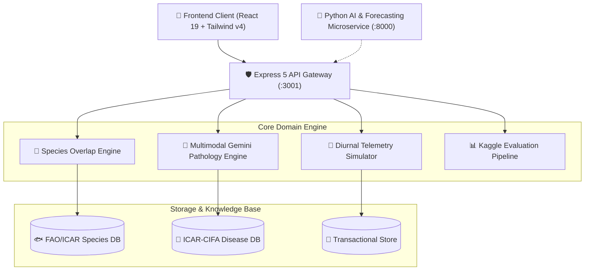

<div align="center">

# 🐟🛡️ FinGuard
### Enterprise Species-Aware Aquaculture Intelligence & Telemetry Platform
**Of the farmers, by the farmers, for the farmers**

[](https://www.typescriptlang.org/)
[](https://react.dev/)
[](https://expressjs.com/)
[](https://vitejs.dev/)
[](https://tailwindcss.com/)
[](https://vitest.dev/)
[](https://www.docker.com/)

[Architecture Specification](docs/ARCHITECTURE.md) • [API Contracts](#-api-reference) • [Docker Deployment](#-docker-orchestration)

</div>

---

## 📌 Executive Overview

**AquaSentinel** is an enterprise aquaculture monitoring and decision-support system engineered for commercial fish farms, polyculture operations, and hatcheries. Unlike generic farm management templates, AquaSentinel grounds every threshold and diagnosis in peer-reviewed biological reference literature from the **Food and Agriculture Organization (FAO)** and the **Indian Council of Agricultural Research (ICAR-CIFA)**.

The platform continuously evaluates pond telemetry, calculates multi-species biological intersection corridors, simulates diurnal oxygen and ammonia oscillations, and provides preliminary multimodal health screening synthesized with uncalibrated model uncertainty boundaries.

---

## 🏛️ System Architecture

AquaSentinel follows a clean monorepo architecture with distinct service boundaries:



---

## 📂 Repository Organization

```
AquaSenital/
├── backend/                     # Express 5 + TypeScript API Microservice
│   ├── src/
│   │   ├── config/              # Centralized environment & app settings
│   │   ├── controllers/         # Request handling & HTTP response mapping
│   │   │   ├── species.controller.ts
│   │   │   ├── disease.controller.ts
│   │   │   ├── simulation.controller.ts
│   │   │   ├── user.controller.ts
│   │   │   └── analytics.controller.ts
│   │   ├── routes/              # Modular Express routing layer
│   │   ├── services/            # Pure business logic and domain processing
│   │   │   ├── geminiScreening.service.ts
│   │   │   ├── simulation.service.ts
│   │   │   ├── kaggle.service.ts
│   │   │   └── storage.service.ts
│   │   ├── middleware/          # Structured logging, error boundaries
│   │   ├── data/                # File-backed persistence store
│   │   ├── app.ts               # Express application configuration
│   │   └── index.ts             # Server entry point with graceful shutdown
│   ├── tests/                   # Vitest automated unit & integration test suites
│   ├── app.py                   # Optional Python ML forecasting microservice
│   ├── package.json
│   ├── tsconfig.json
│   └── Dockerfile
│
├── frontend/                    # Modern React 19 + TypeScript + Vite + Tailwind Client
│   ├── src/
│   │   ├── components/          # Reusable UI controls, gauges, and overlays
│   │   ├── screens/             # Modular application views (Dashboard, Monitoring, Disease, etc.)
│   │   ├── services/            # Client API gateway and sensor interfaces (GPS, Weather)
│   │   ├── constants/           # Multilingual dictionaries (EN, HI, BN, MR, TE, TA)
│   │   ├── styles/              # Global CSS & Tailwind design tokens
│   │   ├── App.tsx              # Application layout & state providers
│   │   └── main.tsx             # DOM bootstrap
│   ├── public/                  # Progressive Web App (PWA) manifest & service worker
│   ├── package.json
│   ├── vite.config.ts
│   └── Dockerfile
│
├── shared/                      # Isomorphic domain models & knowledge catalogs
│   ├── types.ts                 # Authoritative TypeScript types & contracts
│   ├── speciesCatalog.ts        # Operating parameters (FAO & ICAR-CIFA sourced)
│   ├── diseaseCatalog.ts        # Canonical pathology database & clinical markers
│   └── overlapEngine.ts         # Multi-species interval intersection algorithm
│
├── docs/                        # Engineering guides and product visual assets
│   ├── screenshots/             # Production UI screenshots
│   └── ARCHITECTURE.md          # Technical specifications and math models
│
├── docker-compose.yml           # Production multi-container orchestration
├── package.json                 # Monorepo root workspace definitions
└── README.md                    # Project documentation
```

---

## 🔬 Core Engineering Capabilities

### 1. Multi-Species Range Overlap Engine
When co-culturing species in polyculture ponds (e.g., *Labeo rohita*, *Catla catla*, and *Cirrhinus mrigala*), individual physiological tolerance intervals vary. AquaSentinel calculates the strict mathematical intersection:

$$\mathcal{O}_{\text{optimal}} = \left[ \max_{1 \le i \le N}(L_i), \; \min_{1 \le i \le N}(U_i) \right]$$

If $\max(L_i) > \min(U_i)$, a biological conflict is flagged and the bottleneck species is pinpointed, preventing acute osmotic or hypoxic mortality.

### 2. Multimodal AI Diagnostic Screening
The disease detection workflow synthesizes 5 orthogonal data layers:
1. **Host Biology**: Species vulnerability profile and known susceptibilities.
2. **Gross Pathology**: High-resolution user photography with client-side validation.
3. **Pond Telemetry**: Real-time ambient water conditions (DO, Temp, pH, TAN).
4. **Clinical History**: Behavioral symptoms (lethargy, gasping, piping, anorexia).
5. **Veterinary Literature**: Mapped against documented ICAR-CIFA references.

*Outputs include differential diagnoses, non-chemical immediate interventions, and clear prompts for veterinary microscopical confirmation.*

### 3. Diurnal Telemetry Simulation & Hysteresis Alerting
Features a deterministic, seedable simulation engine modeling 24-hour diurnal water chemistry cycles:
- **Algal Respiration Nocturnal Anoxia**: Models midnight-to-dawn dissolved oxygen depletion ($DO < 2.5\text{ mg/L}$).
- **Anti-Chatter Hysteresis**: Requires $k \ge 2$ consecutive out-of-bound readings to trigger an alert and $k \ge 2$ normal samples inside a deadband to clear, eliminating noisy sensor chatter.

---

## 🚀 Quickstart Guide

### Prerequisites
- **Node.js**: v20+ or v24+
- **npm**: v10+
- *(Optional)* **Docker & Docker Compose**

### Installation

Clone the repository and install all dependencies across the workspace:
```bash
git clone https://github.com/harshitag20/FinGuard.git
cd FinGuard
npm install
```

### Environment Configuration
Copy `.env.example` to `.env`:
```bash
cp .env.example .env
```
*(Optional: Provide a `GEMINI_API_KEY` for live multimodal vision analysis. If omitted, the server automatically utilizes its deterministic scientific rule-engine fallback).*

### Running Locally
To launch both the backend microservice and frontend client concurrently:
```bash
npm run dev
```
- **Frontend App**: [http://localhost:3000](http://localhost:3000)
- **Backend API**: [http://localhost:3001](http://localhost:3001)

To run services independently:
```bash
npm run dev:backend   # Starts backend with live reload (port 3001)
npm run dev:frontend  # Starts frontend Vite server (port 3000)
```

### Running Test Suite
Execute the Vitest test suite across backend and domain services:
```bash
npm test
```

---

## 🐳 Docker Orchestration

Run the complete multi-tier system with Docker Compose:

```bash
docker-compose up --build
```
Containers started:
- `aquasentinel-backend`: Express 5 microservice on port `3001`
- `aquasentinel-frontend`: Production Nginx web server on port `3000`

---

## 🔌 API Reference

| Endpoint | Method | Description |
| :--- | :--- | :--- |
| `/api/species` | `GET` | List all 11+ aquaculture species with documented FAO ranges |
| `/api/species/:id` | `GET` | Retrieve specific species biological tolerances |
| `/api/species/overlap` | `POST` | Calculate mathematical tolerance overlap for species combinations |
| `/api/diseases` | `GET` | Retrieve canonical ICAR-CIFA fish disease catalogue |
| `/api/disease/screen` | `POST` | Execute multimodal AI pathology and water co-factor screening |
| `/api/disease/verify` | `POST` | Record repeat water measurements or veterinary microscopy sign-off |
| `/api/simulation/state` | `GET` | Retrieve current diurnal sensor telemetry state |
| `/api/simulation/control`| `POST` | Start, pause, or adjust simulation speed |
| `/api/simulation/inject` | `POST` | Inject acute water anomalies (Anoxia Drop, Ammonia Spike, etc.) |
| `/api/datasets` | `GET` | Scan local Kaggle dataset manifests and licenses |
| `/health` | `GET` | Microservice health check probe |

---

## 📚 Academic & Reference Citations

1. **Food and Agriculture Organization (FAO)**: *Cultured Aquatic Species Information Programme*. FAO Fisheries and Aquaculture Department, Rome.
2. **ICAR - Central Institute of Freshwater Aquaculture (CIFA)**: *Handbooks on Freshwater Fish Disease Diagnosis, Pathology & Sustainable Aquaculture*. Bhubaneswar, India.
3. **Boyd, C. E. (2020)**: *Water Quality: An Introduction*. Springer International Publishing.
4. **Masum Shahriar (2022)**: *Freshwater Fish Disease Dataset*. Kaggle Benchmark (CC BY 4.0).

---

## 📄 License
This project is licensed under the MIT License - see the LICENSE file for details.
