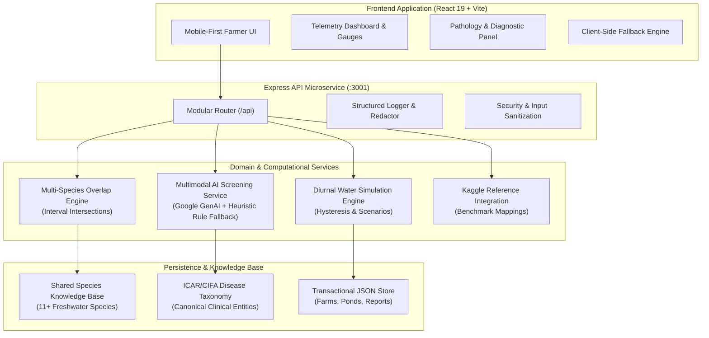

# AquaSentinel - System Architecture & Engineering Specifications

## 1. System Overview

**AquaSentinel** is an enterprise-grade species-aware aquaculture intelligence and IoT telemetry platform designed for commercial fish farms and polyculture operations. It combines mathematical tolerance modeling with real-time sensor streams and multimodal computer vision to predict water quality failures and screen fish pathology before acute mortalities occur.



---

## 2. Monorepo Organization

```
AquaSenital/
├── backend/                     # Dedicated Express + TypeScript microservice
│   ├── src/
│   │   ├── config/              # Centralized environment & app settings
│   │   ├── controllers/         # Request handling & HTTP response mapping
│   │   ├── routes/              # Sub-routers for modular endpoint management
│   │   ├── services/            # Pure business logic, simulations, and AI services
│   │   ├── middleware/          # Request logging, error boundary, validation
│   │   ├── data/                # Persistent database store
│   │   ├── app.ts               # Express configuration & middleware pipeline
│   │   └── index.ts             # Server entry point & graceful shutdown hooks
│   ├── tests/                   # Automated Vitest unit & integration test suites
│   ├── package.json
│   └── Dockerfile
│
├── frontend/                    # Vite + React 19 client application
│   ├── src/
│   │   ├── components/          # Reusable UI components & gauges
│   │   ├── screens/             # Core application screens
│   │   ├── services/            # Client API gateway & device sensors (GPS, Weather)
│   │   ├── constants/           # Multilingual translations & theme design tokens
│   │   ├── styles/              # Global Tailwind CSS definitions
│   │   ├── App.tsx              # Application layout & state providers
│   │   └── main.tsx             # DOM bootstrap
│   ├── public/                  # PWA Web Manifest & Service Worker
│   ├── package.json
│   └── Dockerfile
│
├── shared/                      # Isomorphic domain models & knowledge catalogs
│   ├── types.ts                 # Domain interfaces & protocol schemas
│   ├── speciesCatalog.ts        # Operating parameters (FAO, ICAR-CIFA sourced)
│   ├── diseaseCatalog.ts        # Canonical pathology database & clinical signs
│   └── overlapEngine.ts         # Pure mathematical interval intersection engine
│
├── docs/                        # Architecture guides and product visual assets
│   ├── screenshots/             # Production UI screenshots
│   └── ARCHITECTURE.md          # Technical specifications and math models
│
├── docker-compose.yml           # Production multi-container orchestration
├── package.json                 # Monorepo root workspace definitions
└── README.md                    # Enterprise repository documentation
```

---

## 3. Mathematical Overlap Engine

For polyculture ponds (e.g., cultivating Rohu, Catla, and Mrigal concurrently), individual species exhibit discrete tolerance bounds for water parameters:

$$\text{Optimal Range: } [L_i, U_i]$$

The collective operating corridor for $N$ co-cultured species is calculated by exact closed interval intersection:

$$\mathcal{O}_{\text{optimal}} = \left[ \max_{1 \le i \le N}(L_i), \; \min_{1 \le i \le N}(U_i) \right]$$

If $\max(L_i) > \min(U_i)$, a biological conflict is detected:
$$\mathcal{O}_{\text{optimal}} = \emptyset \quad \Longrightarrow \quad \text{Conflict Detected}$$

The engine alerts the operator to the narrowest bottleneck species and prevents catastrophic thermal or asphyxiation incidents.

---

## 4. Multimodal AI Diagnostic Pipeline

The disease screening pipeline synthesizes 5 orthogonal data layers:

```
[Target Species Profile] + [Live Pond Telemetry] + [Gross Clinical Lesions] + [Diurnal History] + [Veterinary Literature]
                                      │
                                      ▼
             Multimodal Diagnostic Engine (Google Gemini 2.5 / Fallback Rules)
                                      │
                                      ▼
           [Candidate Pathologies with Uncalibrated Qualitative Uncertainties]
           [Water Chemistry Contributing Plausibility Evaluations]
           [Non-Chemical Immediate Mitigations & Veterinary Escalation Advisories]
```

---

## 5. Telemetry & Hysteresis Engine

To prevent false alarms caused by temporary sensor blips or splashing, alerts utilize a dual-threshold hysteresis window:
1. **Breach Condition**: Sensor readings must exceed critical thresholds for $k \ge 2$ consecutive evaluation samples.
2. **Clearance Condition**: Parameter must return within the safe zone plus a clearance deadband for $k \ge 2$ consecutive cycles before alert resolution is registered.

